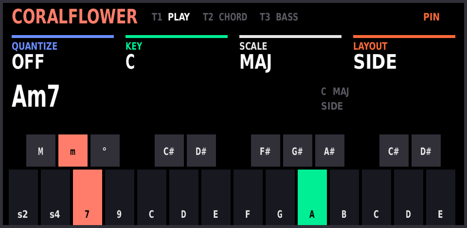
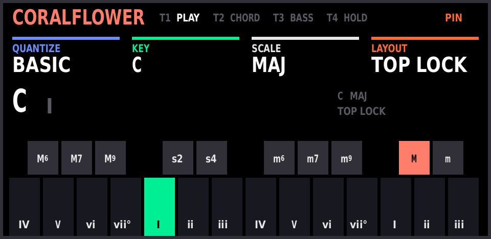
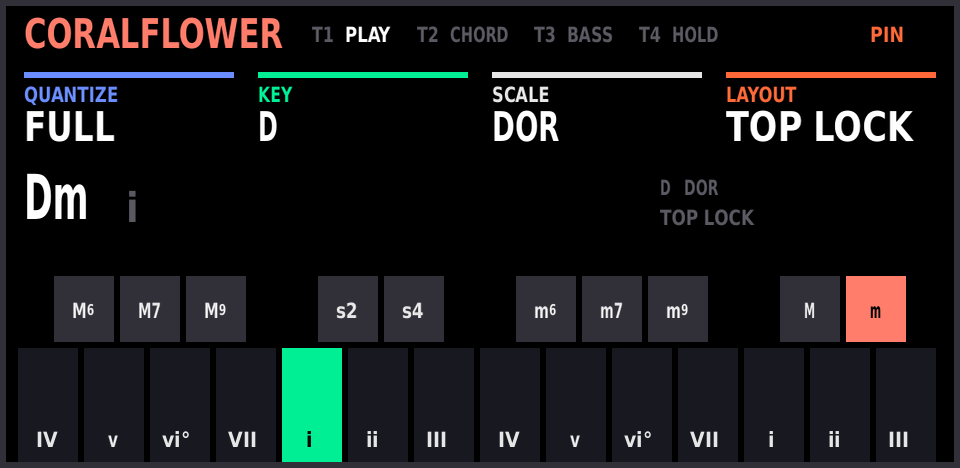
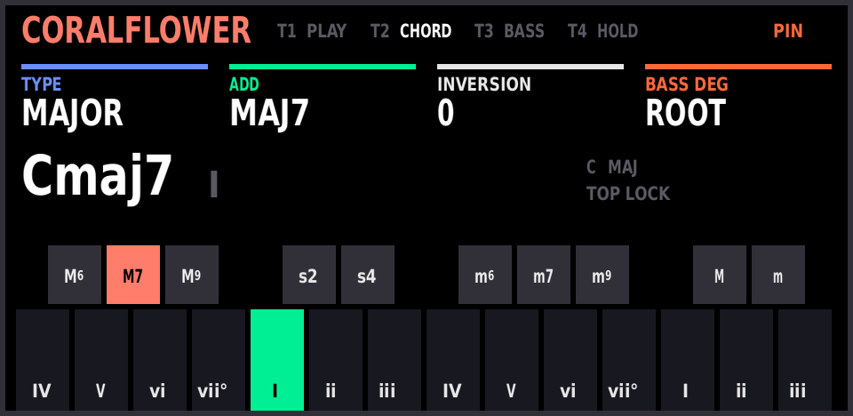
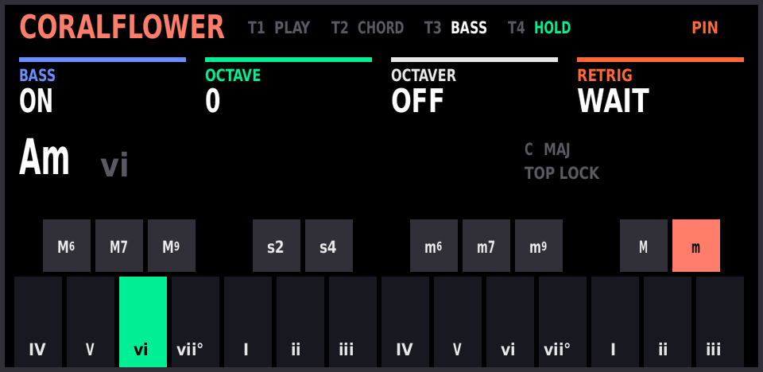
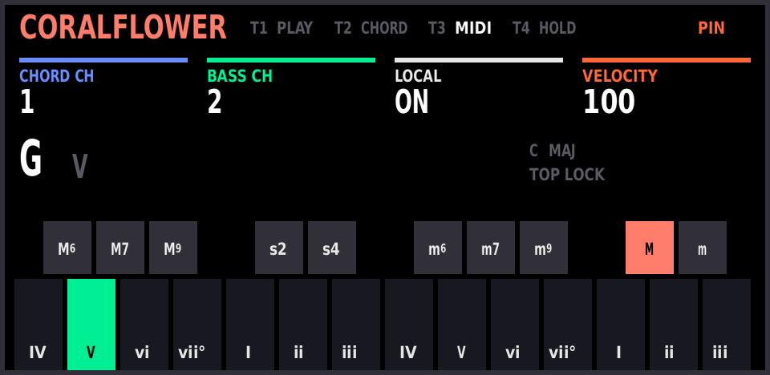
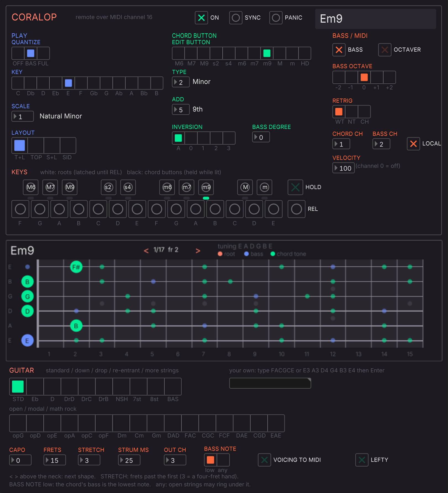

# op1-coralflower

**CoralOP**: [CoralFlower](https://github.com/FicusFicusov/CoralFlower)'s chord instrument (after the Telepathic
Instruments Orchid) on the original OP-1, with chords and bass out over USB MIDI, a plugdata / Pd / Max remote, and
a guitar fretboard that shows every chord on the neck in any tuning.

| | |
|---|---|
| [](docs/images/screen_side.png) | [](docs/images/screen_play.png) |
| **Side**: the Orchid's way. Hold chord buttons (m, 7), play a root (A): Am7 | **Top Lock** (the default): latch a chord button (M), white keys play the key's chords |

*The OP-1's screen, rendered on a PC from the same drawing code that runs on the OP-1
([`coralop/screens/`](coralop/screens)). On the device the text is in the OP-1's own pixel font.*

> **Status: 0.2, experimental.** Flashed and running on an original OP-1 (the minimal image). MIDI into FL, the
> plugdata panel inside FL and the Max panel haven't been confirmed on hardware yet. Read
> [Safe first flash](#safe-first-flash) before you try it.

## Playing it

CoralOP lives in **synth** mode. The keys it uses are printed on the OP-1 as: **shift**, **drop** (the middle of
lift / drop / split, right of the four T keys), **T1–T4**, and the four coloured knobs.

| do this | to |
|---|---|
| **shift + drop** | turn CoralOP on; its panel opens |
| **drop** (alone, while the panel shows) | pin the panel so it stays up while you play; **drop** again unpins and closes it |
| **shift + drop** (while the panel shows) | turn CoralOP off: the OP-1 is stock again |
| **T1 / T2 / T3** (T3 twice) | open the PLAY / CHORD / BASS / MIDI page (also when the panel has closed); the four knobs set its four values |
| **T4** | HOLD (Top layouts): chords keep sounding after you let go |
| octave arrows | move everything by octaves |

Unpinned, the panel closes 5 s after it opened or after the last knob turn or page key (playing doesn't count); a small `CF` badge with the chord's name
stays top right. **Pin it to play live.** Settings are kept until you switch the OP-1 off: after a restart CoralOP
is off, in Top Lock, Quantize Basic, C major.

### Two ways to play: the LAYOUT knob (T1, orange)

**Side**: the Orchid's way, chord shape under your left hand, roots under your right. The lower F#, G#, A# are
**M, m, dim**; the lower F, G, A, B are **sus2, sus4, 7, 9**; every other key, from C up, is a root, laid out as a
piano. Hold one or more chord buttons and play a root: m + 7 on A is Am7, M + 9 on C is Cadd9 (CoralFlower's
names). Let go of the buttons and the roots play single notes. Set QUANTIZE (blue) to **Off** for plain notes, or
leave it on to keep the roots in the key. **Side Lock**: tap the chord buttons to latch them instead. Side has no
HOLD.

**Top Lock** (the default): the ten black keys are chord buttons (`M6 M7 M9 | s2 s4 | m6 m7 m9 | M m`) and the
fourteen white keys are roots. Tap a button to latch it, tap several together to combine them (M + M7 = Maj7), tap
the latched one alone to unlatch. With QUANTIZE Basic or Full the white keys are the key's scale degrees, tonic on
C (the screen shows IV V vi vii° **I** ii iii): pick KEY and SCALE on T1 and every white key plays a chord of that
key. QUANTIZE Off makes the white keys chromatic. **Top**: the buttons work only while held.

| | |
|---|---|
| [](docs/images/screen_play_dorian.png) | [](docs/images/screen_chord.png) |
| **T1 PLAY**: QUANTIZE, KEY, SCALE, LAYOUT. D dorian, Full: the degrees follow the mode | **T2 CHORD**: what the last pressed chord button plays: TYPE, ADD, INVERSION, BASS DEGREE |
| [](docs/images/screen_bass.png) | [](docs/images/screen_midi.png) |
| **T3 BASS**: BASS on/off, OCTAVE, OCTAVER, RETRIG. T4 HOLD lit | **T3 again, MIDI**: CHORD CH, BASS CH, LOCAL (the OP-1's own synth), VELOCITY |

### Out of the OP-1

Chords go out over USB MIDI on **channel 1**, the bass on **channel 2** (both changeable on the MIDI page). With
LOCAL on they also play the OP-1's current synth sound. A computer can drive all of it on channel 16: the
[plugdata panel](remote/README.md) runs inside FL Studio, shows the chord on a guitar neck in any tuning, and
can play the voicing into FL.



*The plugdata panel in plugin mode, fed the same MIDI an OP-1 sends (`remote/tools/shots.py`).*

## What's here

| folder | what |
|---|---|
| [`coralop/`](coralop/README.md) | the firmware feature: how to play it, the pages, MIDI, the tests |
| [`remote/`](remote/README.md) | plugdata / Pd / Max panels, the fretboard, FL Studio setup, the channel-16 protocol |
| `recipes/` | `coralop-min` (stock R246 + CoralOP) and `coralop-full` (op1-sdk's op1plus features + CoralOP) |
| `sdk/` | [op1-sdk](https://github.com/BertBrandstifter/op1-sdk) as a submodule, pinned to `ae1945a` |
| `scripts/` | toolchain setup, build, tests |

**No firmware in this repo.** The OP-1's firmware is teenage engineering's, and so is most of every image built
from it. This repo holds only CoralOP's sources, the remote and the tests; you build the image yourself from your
own copy of `op1_246.op1`. Don't publish built `.op1` files.

## Build

Needs macOS, Linux or WSL, python3, git, and about 2 GB and 30–60 minutes once for the toolchain.

```sh
git clone --recursive https://github.com/txrunn/op1-coralflower
cd op1-coralflower
scripts/setup_toolchain.sh      # once: bfin-elf binutils, GCC, GDB + simulator into sdk/toolchain/
                                #   macOS: op1-sdk's script (Homebrew); Linux/WSL first:
                                #   sudo apt install build-essential libgmp-dev libmpfr-dev libmpc-dev \
                                #        zlib1g-dev texinfo flex bison xz-utils curl
scripts/build.sh /path/to/op1_246.op1 min    # or: full
```

`build.sh` refuses any file that isn't TE's R246 (SHA-256 `c5315218…13a9`; get it from teenage engineering's OP-1
support page) and prints the image's path. Images are reproducible: the same commit and the same R246 always give
the same bytes, so two people can compare SHA-256s.

## Safe first flash

The OP-1's bootloader (te-boot) is never modified, and that's what installs firmware. So whatever CoralOP does, the
Firmware Upload mode below still starts, and flashing your original `op1_246.op1` the same way puts you back on
stock.

1. **Keep `op1_246.op1`** somewhere you'll find it: it's your way back.
2. **Back up** your tapes and sounds: the OP-1's disk mode (COM menu), copy everything off.
3. **Flash `coralop-min` first** (stock plus CoralOP only, so anything odd is CoralOP's): OP-1 off, hold **COM**
   while switching on, choose **Firmware Upload**, copy the `.op1` onto the small disk named `OP-1`, eject. The OP-1
   shows `Found firmware package…` then `Done!`; restart. (On a Mac, `cd sdk && python3 tools/flash.py <image>
   --eject` does the copy, and refuses the wrong disk.)
4. **CoralOP off = stock.** After boot CoralOP is off: check synth, drums, tape, sequencers and USB MIDI behave as
   before.
5. **Turn it on**: shift + drop in synth mode. Work through the [device test](coralop/README.md#device-test):
   chord buttons, roots, T4 HOLD, the T1–T3 pages, then shift + drop again to turn it off with nothing hanging.
6. **MIDI**: with a MIDI monitor on the computer, chords arrive on channel 1, the bass on 2, and CoralOP's state on
   16 once it's on.
7. **The remote**: plugdata in FL, [`remote/README.md`](remote/README.md). Click SYNC; the panel should follow
   the OP-1.
8. Then try `coralop-full` the same way.

**If anything goes wrong** (a hang, a crash at boot, odd sound): switch off, hold COM while switching on, Firmware
Upload, copy `op1_246.op1`. Please open an issue with what you did and what the screen showed.

## Tests

```sh
scripts/test.sh            # host C tests (200,000+ checks), Pd patches, Max core, fretboard (needs pd, node, lua5.4)
scripts/test.sh --bench    # + op1-sdk's feature check and the Blackfin simulator bench (needs the toolchain)
```

Neither needs TE's firmware: the bench runs CoralOP on the simulated Blackfin with TE's functions stubbed. CI runs
both on every push (the toolchain is cached after the first run).

To change the panels, edit `remote/tools/gen_pd.py` / `gen_max.py` and rerun them; CI checks the committed patches
match. `python3 coralop/screens/render.py` redraws the OP-1 screen images (needs cc and Pillow).

## Credits and licence

GPL-3.0-only ([`LICENSE`](LICENSE)), as CoralFlower, whose chord model `coralop/cf_*.c` is copied verbatim
(commit `272cad9`). CoralFlower is by FicusFicusov, a fork of ChoralRoot FM-1 by Quixotic7, a fork of Felucca by
Leo Kuroshita (Hügelton Instruments). op1-sdk (MIT) is by BertBrandstifter; the USB-MIDI send address comes from
op1r by pcppcp (GPL-3.0). OP-1 is teenage engineering's and Orchid is Telepathic Instruments'. This project isn't
affiliated with any of them.

OP-1 port: Tarun Gunaseelan ([@txrunn](https://github.com/txrunn)).
