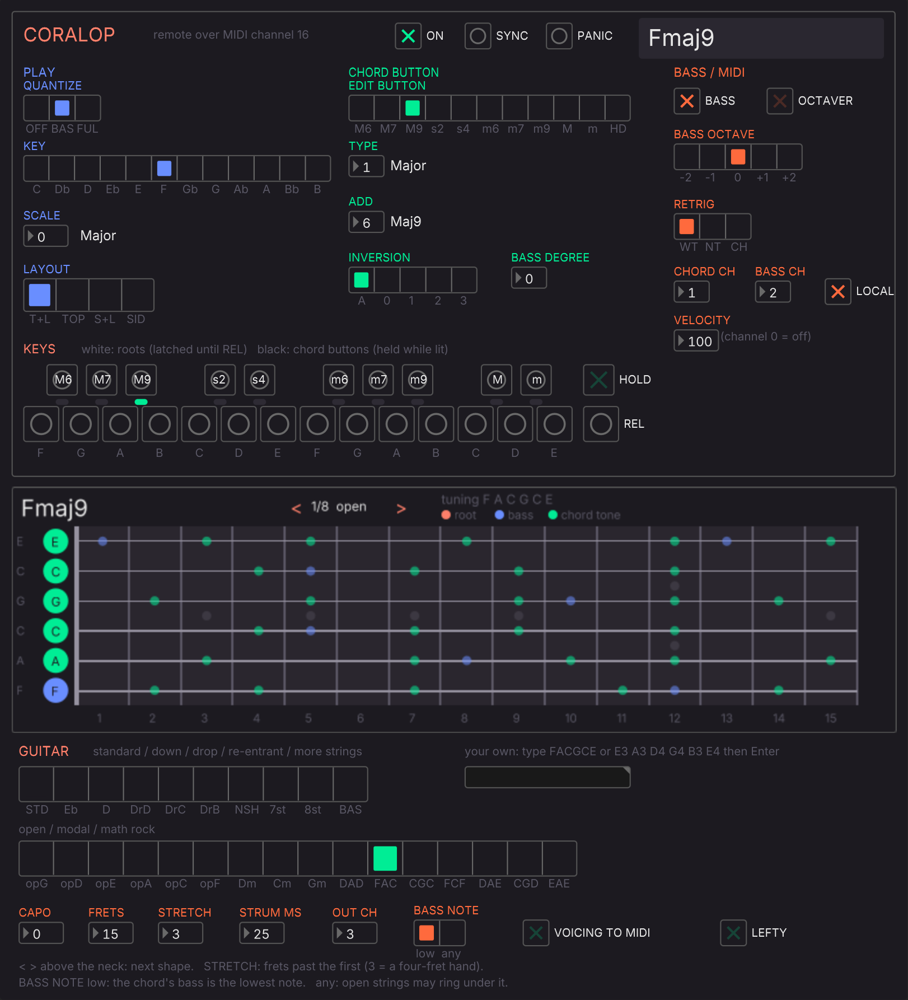

# CoralOP remote — plugdata / Pd / Max, and the guitar neck

CoralOP 0.2 listens on **USB MIDI channel 16**. A computer can play its keys, change every setting and read back
what the OP-1 is doing, including the chord name. This folder has panels that use that, plus a fretboard that shows
the chords on a guitar neck.

| file | what it is |
|---|---|
| `pd/coralop-guitar.pd` | **open this in plugdata**: the panel and the fretboard |
| `pd/coralop-remote.pd` | the panel alone (vanilla Pd 0.52+ or plugdata; also an abstraction) |
| `pd/coralop-voicing.pd` | the fretboard alone, sending its guitar voicing as MIDI (a second plugdata, see below) |
| `pd/coralfret.pd_lua` | the fretboard object (pdlua: built into plugdata; for vanilla Pd install *pdlua* from deken) |
| `pd/coralop-core.pd`, `pd/coralop-guitar-glue.pd` | the protocol and the wiring (keep all `pd/` files together) |
| `max/coralop-remote.maxpat` + `max/coralop-core.js` | the panel for Max 8/9 (keep the two together) |
| `tools/gen_pd.py`, `tools/gen_max.py` | regenerate the patches |
| `tools/shots.py` | the screenshots above, taken in plugdata (Linux: Xvfb, xdotool, ImageMagick, jackd) |
| `tests/run_tests.sh` | the Pd patches against golden output, the Max core in node, the fretboard logic in Lua |

## FL Studio + plugdata (Windows and Mac)

1. Flash CoralOP 0.2 and connect the OP-1 by USB. You don't need to press shift + insert: the panel's **ON** turns
   CoralOP on.
2. In FL, open **Options › MIDI settings**.
   - **Output:** select the OP-1 and set **Port** to `1`.
   - **Input:** select the OP-1, click **Enable**, and set **Port** to `1`.
   - Make sure **Options › Enable MIDI output** is ticked.
3. Add **plugdata** to the Channel Rack as an instrument (the VST3). In plugdata, open `pd/coralop-guitar.pd`,
   then click the **plug button** at the top right for plugin mode: just the panel, as in the picture. (Click the
   pencil at its top right to get back to the patch.) plugdata stores the patch with your FL project.
4. In plugdata's wrapper, open the gear menu, then **VST wrapper settings**, then **MIDI**. Set the **output port**
   to `1` (CoralOP's controls go to the OP-1) and the **input port** to `1` (the OP-1's state and notes come back).
5. Click **SYNC**: the panel takes on the OP-1's settings and keeps following them.

**Recording the chords:** CoralOP plays chords on MIDI channel 1 and the bass on channel 2, and both arrive in FL
through input port 1. In each instrument's wrapper, set its MIDI input port to `1` (and its channel, where the
instrument has one).

**Sequencing CoralOP from FL's piano roll:** add a **MIDI Out** channel with port `1` and channel `16`. Notes
53–76 are the OP-1's 24 keys and 78 is HOLD. FL calls middle C "C5", so in its piano roll that's **F4–E6, with HOLD
on F#6**. Write chord-button notes (the black keys) and root notes (the white keys); the OP-1 builds the chords and
plays them back in on channels 1 and 2.

**Guitar voicings into FL:** plugdata has a single MIDI output, and that one goes to the OP-1. For the voicings, add
a **second plugdata** with `pd/coralop-voicing.pd`, input port `1` and output port `2`, then give a guitar instrument
input port `2`. Its **VOICING TO MIDI** starts on: every chord you play on the OP-1 is played again as the shape on
the neck, strummed low to high on **OUT CH** (3). Record those notes, or change the shape with `<` `>`.

## The fretboard

It shows every chord tone along the neck: the bass in blue, the root in coral (when it isn't also the bass), the
other tones in green. The
**shape** is the larger dots: one note per string, at most four fingers (a barre counts as one) within four frets,
open strings allowed, and the chord's bass on the lowest string played. **`<` `>`** above the neck step through
the shapes from the nut upwards. When the chord changes, the next shape is the one nearest to where your hand
already is. A single note (no chord) shows every place that note can be played.

- **Tunings:** two rows of presets. The first is standard and lowered: standard, Eb, D, drop D, drop C, drop B,
  Nashville, 7-string, 8-string and bass. The second is open, modal and math rock: open G, D, E, A, C and F, open
  Dm, Cm and Gm, DADGAD, FACGCE, CGCGCE, FACFCF, DADEAD, CGDGBD and EADEAE. For anything else, type it into the box under
  **your own** and press Enter:
  - **Letters** like `FACGCE`, `DADF#AD` or `EbAbDbGbBbEb`. The lowest string lands near E2 and each next string is
    the nearest note above the one before. In all-lowercase input, `b` is the note B.
  - **Octaves** like `E3 A3 D4 G4 B3 E4`. Use these when a string is lower than the one below it (Nashville,
    re-entrant or "B below G" tunings). The bass rule goes by pitch, not by string, so these work.
  - Other patches can send `tuning …` to the fretboard the same way.
- **STRETCH** (2–5): how many frets past the first fret your hand covers. 3 means four frets; 4 or 5 opens up
  wide math-rock shapes.
- **BASS NOTE** `low`: the chord's bass is the lowest note (what the OP-1's bass plays). `any`: open low strings
  can ring under the chord, but shapes with the real bass still come first.
- Open strings: in standard-type tunings they're kept to the first position. In open and altered tunings they're
  preferred anywhere on the neck, so every open tuning's open strum shows up as its chord's first shape, and a
  major chord up the neck in open E is a one-finger barre.
- Tested: every major, minor, 7, maj7, m7, sus2, sus4, add9, m9 and maj9 chord in all 12 keys finds a shape in
  every preset, including FACGCE and Nashville (the ukulele preset misses some five-note chords, since it has four
  strings). Every shape found is checked, and so are 300 random tunings (strings in any order, unisons, a capo).
- **CAPO**, **FRETS** (12–24; fewer is lighter), **STRUM MS**, **OUT CH**, **LEFTY**.
- Other patches can feed it with `[s coralop-notes]` ("pitch vel ch", as from `[notein]`) and
  `[s coralop-state]`.

It runs in plugdata's audio thread. Working out the shapes takes under 1 ms per chord change on a desktop CPU.
The heaviest setting (8 strings, STRETCH 5, 24 frets, BASS NOTE any) is capped at about 15 ms; at a very small FL
buffer, keep STRETCH at 3.

## Pure Data on its own

Open `pd/coralop-remote.pd` (or `coralop-guitar.pd` with pdlua installed) and pick the OP-1 under
**Media › MIDI Settings** for both input and output. On Windows, only one program can open the OP-1 at a time
unless you have Windows MIDI Services, so use plugdata inside FL there. macOS shares MIDI ports.

## Max

Open `max/coralop-remote.maxpat`; it opens in presentation mode. Double-click `[ctlout 0 16]` and `[noteout 16]` in
the patching view and pick the OP-1; `[ctlin]` listens to every input. The keyboard (`kslider`, polyphonic) holds a
key on the first click and lets it go on the second: F3–E5 are the OP-1's keys and F#5 is HOLD. Max can't host the
fretboard and doesn't run inside FL; it talks to FL through the IAC driver (Mac) or loopMIDI (Windows).
*The JS core is tested in node; the patch itself hasn't been opened in Max yet.*

## The protocol (channel 16)

| CC | parameter | values |
|---|---|---|
| 20 | enable | 0 off, 127 on (taken even while CoralOP is off) |
| 21 | quantize | 0 off, 1 basic, 2 full |
| 22 | key | 0–11 (C…B) |
| 23 | scale | 0–26 (CoralFlower's order: Major, Natural Minor, … Chromatic) |
| 24 | layout | 0 Top Lock, 1 Top, 2 Side Lock, 3 Side |
| 25 | retrig | 0 Wait, 1 Notes, 2 Chord |
| 26 / 28 | bass / octaver | 0 off, 127 on |
| 27 | bass octave | 62–66 (−2…+2) |
| 29 / 30 | chord / bass channel | 1–16, 0 off |
| 31 | local (the OP-1's own synth) | 0 off, 127 on |
| 102 | velocity | 1–127 |
| 104 | the chord button being edited | 0–10 (Top), 0–6 (Side) |
| 105–108 | its type, add, inversion (0 auto, 1–4 = 0–3), bass degree | as the panel shows |
| 109 | panic: all notes off, latches and HOLD cleared | any |
| 110 | send the whole state | any (taken even while CoralOP is off) |

Notes 53–76 on channel 16 are the 24 keys and 78 is HOLD. While CoralOP is on, all of channel 16 belongs to it;
while it is off, only CC 20 and CC 110 are taken.

Back from the OP-1 (channel 16, on every change once a host has spoken or CoralOP is on): the CCs above, plus
**112/113** the lit chord buttons (bits 0–6 / 7–10), **114** HOLD, **115** the root pitch class (127: none),
**116** sounding, **117** the length of the chord name, then **118** one ASCII character each (`°` is spelt `dim`,
`ø7` `m7b5`).
